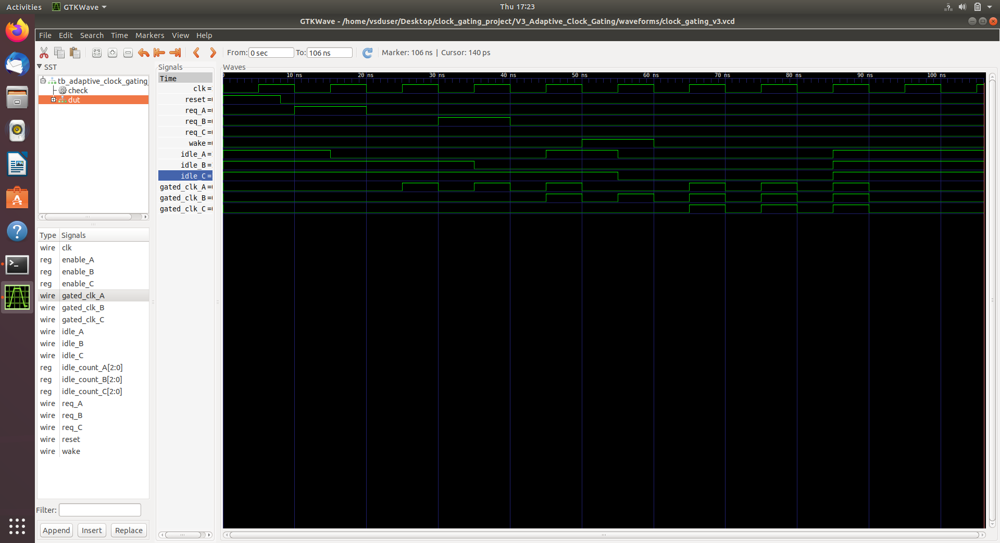
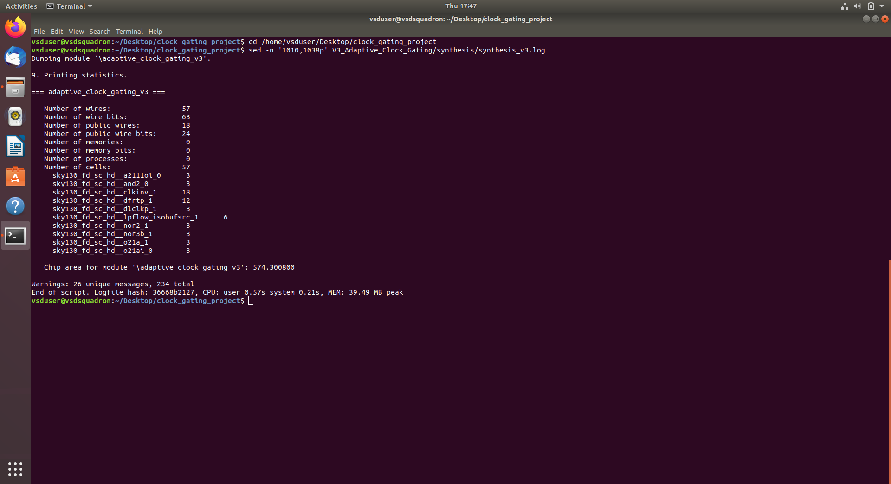
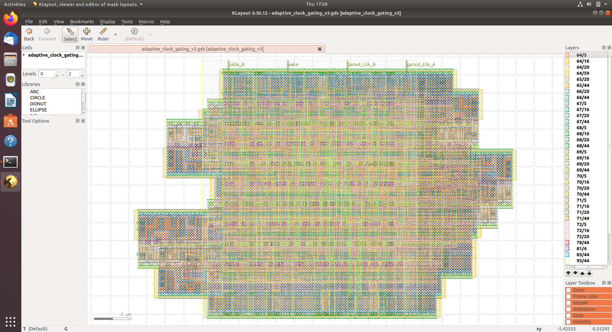
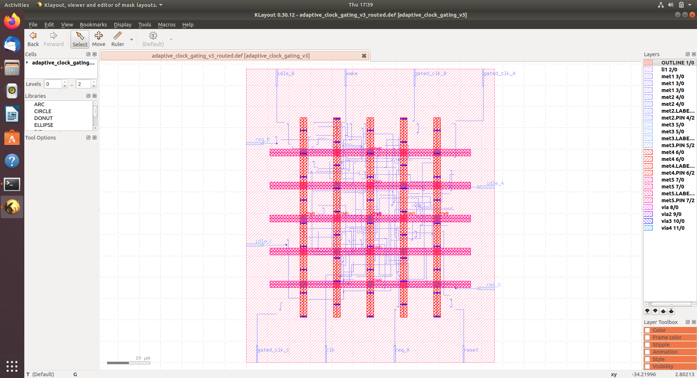
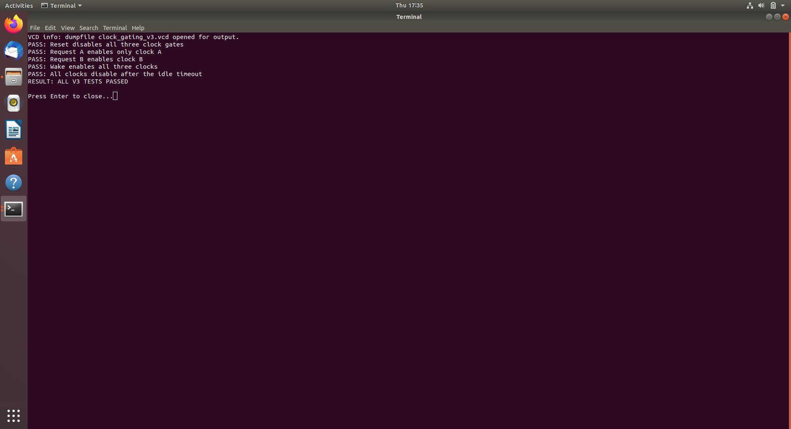
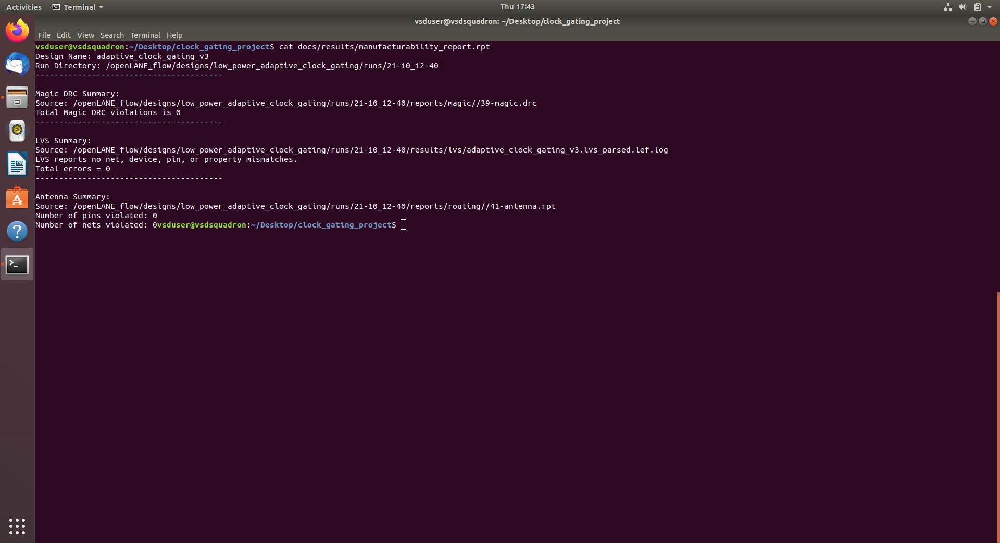

# Low-Power Adaptive Clock Gating Controller

## Overview

This project implements an adaptive clock-gating controller for three
independent blocks using Verilog RTL and the SKY130 standard-cell library.

The controller monitors activity requests and idle periods, enabling or
disabling each block's clock according to the programmed idle threshold.

## Features

- Three independently controlled clock-gated blocks: A, B, and C
- Request inputs: req_A, req_B, req_C
- Wake input to reactivate the blocks
- Idle detection using configurable counters
- Integrated clock-gating cells: sky130_fd_sc_hd__dlclkp_1
- Default idle threshold: 3 clock cycles

## Tools and Technology

- Verilog RTL
- Icarus Verilog simulation
- Yosys synthesis
- OpenSTA timing analysis
- OpenLane v0.21 physical-design flow
- SKY130A / sky130_fd_sc_hd
- KLayout and Magic

## RTL Simulation

The V3 testbench passed these checks:

- Reset disables all three clock gates
- Request A enables only clock A
- Request B enables clock B
- Wake enables all three clocks
- All clocks disable after the idle timeout

See `V3_Adaptive_Clock_Gating/reports/regression_v3.log`.

## Timing Analysis

Pre-layout STA was run with a 10 ns clock constraint at three PVT corners.

| Corner | WNS | TNS |
|---|---:|---:|
| TT_025C_1v80 | 8.56 ns | 0 ns |
| SS_100C_1v40 | 7.15 ns | 0 ns |
| FF_n40C_1v95 | 8.74 ns | 0 ns |

These are preliminary pre-layout results and are not post-route signoff.

The available OpenLane post-resizer timing report includes selected paths
with positive slack, including a 0.26 ns clock-gating hold check. However,
the available SPEF timing report says "No paths found", and detailed routed
timing reports are empty. Complete post-route timing closure has therefore
not been established by the available reports.

## Physical Design and Verification

The OpenLane run `21-10_12-40` completed successfully.

Reported results include:

- Magic DRC violations: 0
- TritonRoute violations: 0
- Antenna violations: 0
- LVS summary total errors: 0

These are the reported results from this run and should not be interpreted
as independent foundry signoff.

## Results

See `docs/results/` for the final GDS files and selected reports.

The final layout can be opened in KLayout using a generated GDS file.

## Main RTL

`V3_Adaptive_Clock_Gating/rtl/adaptive_clock_gating_v3.v`

## Simulation Testbench

`V3_Adaptive_Clock_Gating/simulation/tb_adaptive_clock_gating_v3.v`
+
## Project Screenshots

### RTL Simulation Waveform

### Yosys Synthesis Results

### Final GDS Layout

### Routed Physical Design

### Functional Verification

### Physical Verification

